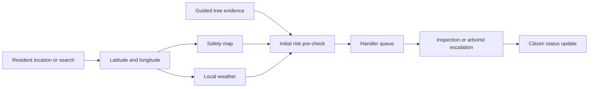

# TreeWatch Township

> A location-aware public tree-safety reporting and township response prototype.

## Live prototype

**[Open TreeWatch Township](https://kimister12.github.io/treewatch-prototype/)**

The link opens the current mobile-first prototype directly. For the best demonstration, allow location access or search for a Malaysian township manually.

## The problem

Tree hazards are often reported through unstructured messages with incomplete locations and unclear photographs. During heavy rain or strong winds, township teams also need a defensible way to decide which reported trees should be checked first.

TreeWatch turns resident observations into structured, location-aware reports and gives township handlers a shared operational view. The prototype connects guided evidence capture, duplicate-report merging, 15-metre fall-zone awareness, live local weather, transparent risk ranking, and closed-loop citizen updates.

## Who it serves

- **Residents and citizens:** report visible warning signs, check nearby caution zones, view local storm advisories, and track report status.
- **Township handlers:** review mapped reports, prioritise inspections using weather-sensitive risk ranking, update workflow stages, and escalate complex cases to qualified arborists.

## Key features

### Resident experience

- **Smart Scan & Report:** a four-step flow for location, guided photographs, visible warning cues, and review.
- **Guided evidence:** whole-tree, trunk-base, and canopy photographs with simulated quality checks and privacy protection.
- **Location choice:** Elmina is the default demonstration area; residents can search another Malaysian location or use precise device GPS.
- **Duplicate awareness:** nearby reports are merged into one tree ticket rather than flooding the handler queue.
- **Neighborhood Safety Map:** live OpenStreetMap tiles, reported-tree markers, status counters, and 15-metre caution zones.
- **Location-based weather:** current temperature, expected rainfall, gusts, and hourly conditions update using the same selected coordinates as the map.
- **My Reports:** a visible status timeline showing Reported, Scheduled, Inspected, and Mitigated stages.

### Township handler experience

- **Operational overview:** risk distribution, high-priority reports, ownership, status, and pilot KPIs.
- **Storm re-ranker:** adjustable wind and rainfall inputs demonstrate how changing conditions reorder inspection priorities.
- **Triage workflow:** a closed-loop queue for scheduling, inspection, mitigation, and citizen notification.
- **Expert escalation:** difficult or severe cases can be packaged for final assessment by an ISA-certified arborist.

### Risk logic

TreeWatch communicates a transparent prioritisation concept:

```text
Risk = Likelihood × Consequence × Storm Factor
```

- **Likelihood:** severity of visible warning cues such as lifted roots, major lean, cracks, or dead branches.
- **Consequence:** people, roads, buildings, playgrounds, parking bays, or other targets within the estimated fall zone.
- **Storm Factor:** rainfall and wind conditions that may increase urgency.

## End-to-end workflow

1. A resident selects Elmina, searches another area, or grants GPS access.
2. The resident captures guided tree photographs and selects visible warning cues.
3. The prototype combines the evidence, surroundings, and weather into an initial prioritisation score.
4. Reports for the same tree are represented as one merged ticket with a neighbor counter.
5. Handlers review the ranked queue and schedule the highest-priority visual checks.
6. Severe or uncertain cases are escalated to a qualified arborist.
7. Every reporting resident receives status updates until mitigation is recorded.

## Prototype structure

```text
treewatch-prototype/
├── index.html                 # Redirects directly to the current prototype
├── README.md                  # Hackathon submission overview
└── prototype-1/
    ├── index.html             # Resident app and handler dashboard
    └── assets/                # Demonstration tree photographs
```

The application is a static, single-page prototype. It does not require a build step or package installation.

## Technology

| Layer | Technology | Purpose |
|---|---|---|
| Interface | HTML, CSS, vanilla JavaScript | Mobile-first resident app and responsive handler dashboard |
| Mapping | Leaflet + OpenStreetMap | Interactive location map, markers, and 15m fall-zone overlays |
| Location | Browser Geolocation API | High-accuracy device positioning with an accuracy indicator |
| Search | OpenStreetMap Nominatim | Forward search for Malaysian townships and addresses |
| Place labels | BigDataCloud reverse geocoding | Converts GPS coordinates into readable area labels |
| Weather | Open-Meteo | Coordinate-based current and hourly weather conditions |
| Hosting | GitHub Pages | Public hackathon demonstration |

### Data flow



## Safety, privacy, and responsible use

- TreeWatch never declares a tree safe from photographs alone.
- The displayed visible-defect percentage is a prototype score, not a certified probability or professional tree-risk assessment.
- Internal decay and structural weakness may not be visible in resident photographs.
- High-risk, uncertain, or technically complex cases require on-site assessment by trained personnel and, where appropriate, a qualified arborist.
- Residents are instructed to keep away from an actively falling tree, blocked road, fallen power line, or immediate danger and contact emergency services.
- The interface demonstrates automatic face and vehicle-plate blurring before evidence upload.

## Prototype scope

This repository demonstrates the user experience and operational concept. The following elements currently use demonstration data:

- Reported-tree records and their positions around the selected map location.
- Duplicate-report counts, ownership, workflow history, and notifications.
- Visible-defect scores, risk tiers, handler KPIs, and arborist decisions.

A production deployment would require authenticated users, a geospatial report database, secure media storage, notification services, audited scoring logic, consent and retention controls, and validation using arborist-labelled cases.

## Proposed pilot measures

- At least **80%** of resident scans completed in under two minutes.
- **50%** reduction in report-to-inspection turnaround time.
- At least **80%** of high-risk trees inspected before storm season.
- At least **90% recall** on arborist-confirmed high-risk trees.
- At least **50%** of arborist escalations confirmed as necessary.
- Status updates delivered to **100%** of residents attached to a tree ticket.

## Running and reviewing the prototype

Use the **Live prototype** link for the hackathon submission. Reviewers are taken directly to the current TreeWatch experience.

Suggested demonstration path:

1. Complete the resident **Smart Scan** flow.
2. Open **Safety Map**, search for a Malaysian location, and show the synchronized map and weather update.
3. Open **Storm Advisory** and explain location-specific caution information.
4. Open **My Reports** to demonstrate closed-loop updates.
5. Switch to **Handler** to demonstrate risk mapping, storm ranking, triage, and arborist escalation.

For local review, download or clone the repository and serve its root with any static web server. Browser location access works only in a secure context such as HTTPS or localhost.

## Team and submission

Built as a hackathon prototype for safer, faster, and more transparent township tree-risk reporting.

- **Repository:** [github.com/kimister12/treewatch-prototype](https://github.com/kimister12/treewatch-prototype)
- **Live submission:** [kimister12.github.io/treewatch-prototype](https://kimister12.github.io/treewatch-prototype/)

---

TreeWatch supports prioritisation and communication; it does not replace professional arboricultural assessment or emergency services.
